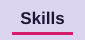
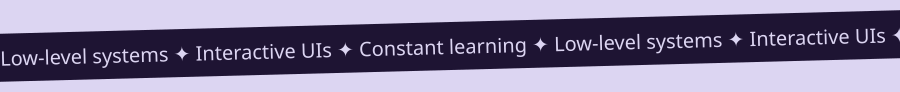
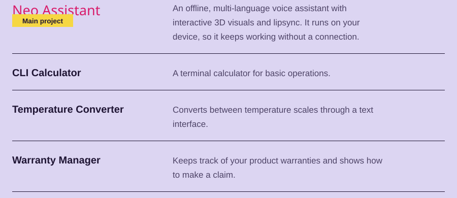
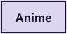
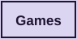
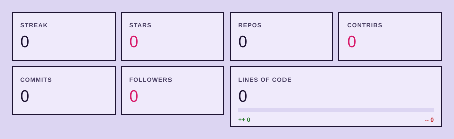
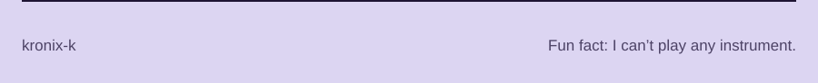

<a href="#what-im-working-on"><picture><source media="(prefers-color-scheme: dark)" srcset="assets/nav_projects_dark.svg"><source media="(prefers-color-scheme: light)" srcset="assets/nav_projects_light.svg"></picture></a>&nbsp;<a href="#languages-and-tools"><picture><source media="(prefers-color-scheme: dark)" srcset="assets/nav_skills_dark.svg"><source media="(prefers-color-scheme: light)" srcset="assets/nav_skills_light.svg"></picture></a>&nbsp;<a href="#logbook"><picture><source media="(prefers-color-scheme: dark)" srcset="assets/nav_log_dark.svg"><source media="(prefers-color-scheme: light)" srcset="assets/nav_log_light.svg"></picture></a>&nbsp;<a href="#say-hi"><picture><source media="(prefers-color-scheme: dark)" srcset="assets/nav_contact_dark.svg"><source media="(prefers-color-scheme: light)" srcset="assets/nav_contact_light.svg"></picture></a>

<picture><source media="(prefers-color-scheme: dark)" srcset="assets/hero_dark.svg"><source media="(prefers-color-scheme: light)" srcset="assets/hero_light.svg"></picture>

<a href="#what-im-working-on"><picture><source media="(prefers-color-scheme: dark)" srcset="assets/btn_0_dark.svg"><source media="(prefers-color-scheme: light)" srcset="assets/btn_0_light.svg"></picture></a>&nbsp;&nbsp;<a href="https://github.com/kronix-k"><picture><source media="(prefers-color-scheme: dark)" srcset="assets/btn_1_dark.svg"><source media="(prefers-color-scheme: light)" srcset="assets/btn_1_light.svg"></picture></a>&nbsp;&nbsp;<a href="https://kronix-k.github.io/kronix-k/"><picture><source media="(prefers-color-scheme: dark)" srcset="assets/btn_live_dark.svg"><source media="(prefers-color-scheme: light)" srcset="assets/btn_live_light.svg"></picture></a>

<picture><source media="(prefers-color-scheme: dark)" srcset="assets/marquee_dark.svg"><source media="(prefers-color-scheme: light)" srcset="assets/marquee_light.svg"></picture>

## What I’m working on

One main project and a few utilities I’m building to learn.

<picture><source media="(prefers-color-scheme: dark)" srcset="assets/projects_dark.svg"><source media="(prefers-color-scheme: light)" srcset="assets/projects_light.svg"></picture>

## Languages and tools

What I reach for most.

<picture><source media="(prefers-color-scheme: dark)" srcset="assets/skills_dark.svg"><source media="(prefers-color-scheme: light)" srcset="assets/skills_light.svg"></picture>

## Logbook

Anime I’ve watched and games I’ve played, with honest ratings. Tap a title to read my notes. *(Click a tab, then a title.)*

<picture><source media="(prefers-color-scheme: dark)" srcset="assets/tab_anime_dark.svg"><source media="(prefers-color-scheme: light)" srcset="assets/tab_anime_light.svg"></picture>

<b>Kizumonogatari</b> &nbsp;·&nbsp; <i>Absolute cinema</i>

<blockquote>Action, Supernatural, Vampire, Drama · Shaft · 3 movies · 2016–2017
I was confused at first: the dialogue, wordplay and literary references are hard to follow if you aren’t Japanese. What won me over was the animation and the fights. Shaft blends 2D and 3D seamlessly, and the cinematography kept me hooked even when I missed a reference.
</blockquote>

<b>Nisemonogatari</b> &nbsp;·&nbsp; <i>I need two sisters</i>

<blockquote>Mystery, Supernatural, Comedy · Shaft · 11 episodes · 2012
A lot of fan service, but I liked it anyway. The toothbrushing scene is a highlight, though it isn’t my main focus. I enjoyed the story too.
</blockquote>

<b>Nekomonogatari (Kuro)</b> &nbsp;·&nbsp; <i>にゃ/10</i>

<blockquote>Supernatural, Psychological, Drama · Shaft · 4 episodes · 2012
Set before Bakemonogatari, it explores Tsubasa Hanekawa’s past as she struggles with the supernatural side of her repressed emotions. She is the biggest reason I love this arc: kind, caring, adorable, and one of my favorite characters in the series. Her outfits are great too.
</blockquote>

<b>Owarimonogatari 2nd Season</b> &nbsp;·&nbsp; <i>7/10</i>

<blockquote>Mystery, Supernatural, Psychological · Shaft · 7 episodes · 2017
It wraps up many of the mysteries, but I had a hard time following the plot and the ending didn’t land like the earlier arcs. Still the same unique storytelling and visual style.
</blockquote>

<b>Hanamonogatari</b> &nbsp;·&nbsp; <i>Tomboy/10</i>

<blockquote>Drama, Supernatural, Psychological · Shaft · 5 episodes · 2014
Suruga Kanbaru is my waifu and the biggest reason I love this arc. I’ve always had a soft spot for tomboy characters, and her energy lifts every scene. One of my favorite entries.
</blockquote>

<b>High School DxD</b> &nbsp;·&nbsp; <i>That should have been me</i>

<blockquote>Action, Comedy, Ecchi, Fantasy, Harem · TNK · 12 episodes · 2012
I kept thinking “that should have been me.” The mix of action, comedy and ecchi kept every episode fun, and I never skip the opening, Trip -innocent of D-.
</blockquote>

<picture><source media="(prefers-color-scheme: dark)" srcset="assets/tab_games_dark.svg"><source media="(prefers-color-scheme: light)" srcset="assets/tab_games_light.svg"></picture>

<b>Yakuza 0</b> &nbsp;·&nbsp; <i>10/10</i>

<blockquote>Action, Beat ’em up, Crime drama
There was always something fun to do: karaoke, arcades, running the real estate business, random side activities. Behind the goofy moments is an excellent story, and Majima’s was my favorite.

<a href="https://store.steampowered.com/app/638970/Yakuza_0/">View on Steam</a>
</blockquote>

<b>The Witcher 3: Wild Hunt</b> &nbsp;·&nbsp; <i>9.5/10</i>

<blockquote>Open-world RPG, Fantasy
My Intel Iris Xe fought for its life the whole time. The huge world, exploration and medieval atmosphere won me over anyway. Perfect if you like getting lost for hundreds of hours.

<a href="https://store.steampowered.com/app/292030/the_witcher_3_wild_hunt/">View on Steam</a>
</blockquote>

<b>Blasphemous</b> &nbsp;·&nbsp; <i>9/10</i>

<blockquote>Action platformer, Soulslike, Gothic
I saw. I played. I left. The art alone earns the 9/10. Finishing it is something I’ll leave to people with actual skill.

<a href="https://store.steampowered.com/app/774361/Blasphemous/">View on Steam</a>
</blockquote>

<b>The King is Watching</b> &nbsp;·&nbsp; <i>9/10</i>

<blockquote>Roguelite, Kingdom builder, RTS
I only played the demo, but it left a strong impression: a unique concept, beautiful art and simple, fun gameplay. I haven’t tried the full version yet.

<a href="https://store.steampowered.com/app/2753900/The_King_is_Watching/">View on Steam</a>
</blockquote>

<b>ENDER LILIES: Quietus of the Knights</b> &nbsp;·&nbsp; <i>8.5/10</i>

<blockquote>Metroidvania, Action
My first soulslike, so it holds a special place. Many call it one of the easier ones, but it made me fall in love with the genre. The art, gameplay and melancholic story stayed with me.

<a href="https://store.steampowered.com/app/1369630/ENDER_LILIES_Quietus_of_the_Knights/">View on Steam</a>
</blockquote>

<b>Refind Self: The Personality Test Game</b> &nbsp;·&nbsp; <i>8.2/10</i>

<blockquote>Psychological, Narrative, Exploration
I liked the art and the idea of finding your personality through actions instead of a questionnaire. The results felt too generic, like one template with a few details swapped.

<a href="https://store.steampowered.com/app/2514960/Refind_Self_The_Personality_Test_Game/">View on Steam</a>
</blockquote>

<b>Feeding Frenzy 2 Deluxe</b> &nbsp;·&nbsp; <i>7/10</i>

<blockquote>Arcade, Casual
When my parents bought my first PC in first grade, I played the original Feeding Frenzy all night. The gameplay is simple, but the nostalgia is priceless: it’s where my love for PC games began.

<a href="https://store.steampowered.com/app/3390/Feeding_Frenzy_2_Deluxe/">View on Steam</a>
</blockquote>

<b>美女，请别影响我学习</b> &nbsp;·&nbsp; <i>Avril Lin is mine</i>

<blockquote>Visual novel, Slice of life, School sim
I play it for Avril Lin, my favorite character. The story is average, but the cute cast and their interactions kept me interested. Surprisingly relaxing when you spend a lot of time alone.

<a href="https://store.steampowered.com/app/2786680/_/?l=schinese">View on Steam</a>
</blockquote>

## Say hi

The best place to find my code is GitHub.

<a href="https://github.com/kronix-k"><picture><source media="(prefers-color-scheme: dark)" srcset="assets/btn_contact_dark.svg"><source media="(prefers-color-scheme: light)" srcset="assets/btn_contact_light.svg"></picture></a>

## GitHub stats

<picture><source media="(prefers-color-scheme: dark)" srcset="assets/stats_dark.svg"><source media="(prefers-color-scheme: light)" srcset="assets/stats_light.svg"></picture>

<picture><source media="(prefers-color-scheme: dark)" srcset="assets/footer_dark.svg"><source media="(prefers-color-scheme: light)" srcset="assets/footer_light.svg"></picture>
