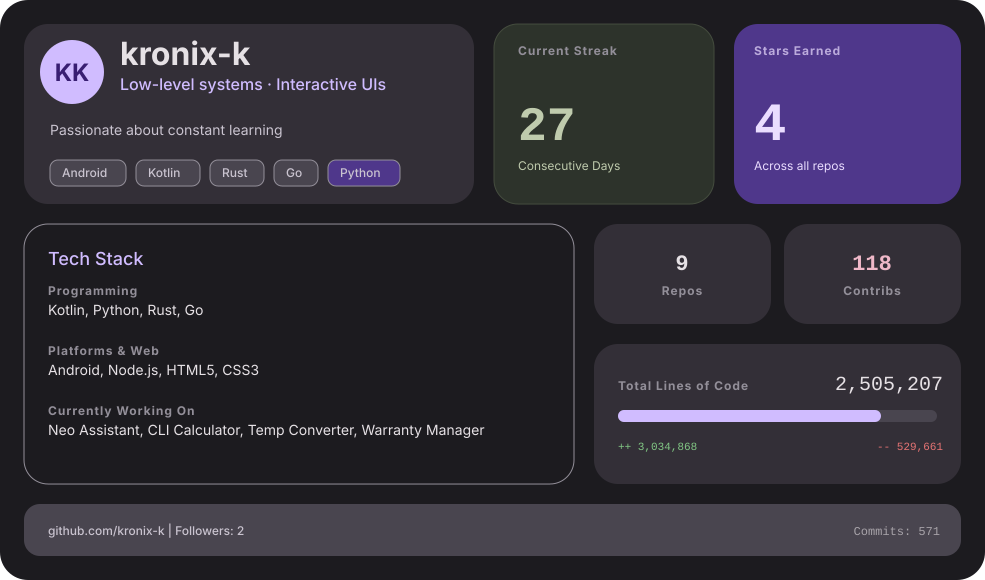

<a href="https://github.com/kronix-k" target="_blank" rel="noreferrer">
  <picture>
    <source media="(prefers-color-scheme: dark)" srcset="dark_mode.svg">
    <source media="(prefers-color-scheme: light)" srcset="light_mode.svg">
    
  </picture>
</a>

 

🎮 **Steam:** [Endless Lilies](https://store.steampowered.com/app/1369630/ENDER_LILIES_Quietus_of_the_Knights/) · [Yakuza Zero](https://store.steampowered.com/app/638970/Yakuza_0/) · [Blasphemous](https://store.steampowered.com/app/774361/Blasphemous/) · [Feeding Frenzy 2 Deluxe](https://store.steampowered.com/app/3390/Feeding_Frenzy_2_Deluxe/) · [Refind Self: The Personality Test Game](https://store.steampowered.com/app/2514960/Refind_Self_The_Personality_Test_Game/) · [The Witcher 3: Wild Hunt](https://store.steampowered.com/app/292030/the_witcher_3_wild_hunt/) · [美女，请别影响我学习 (Knowledge, or know Lady)](https://store.steampowered.com/app/2786680/_/?l=schinese) · [The King is Watching](https://store.steampowered.com/app/2753900/The_King_is_Watching/)

  

